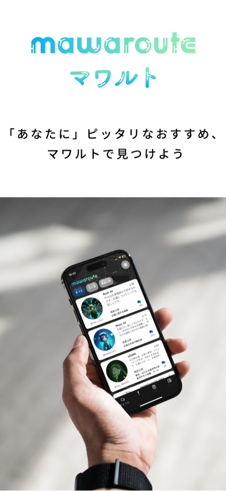
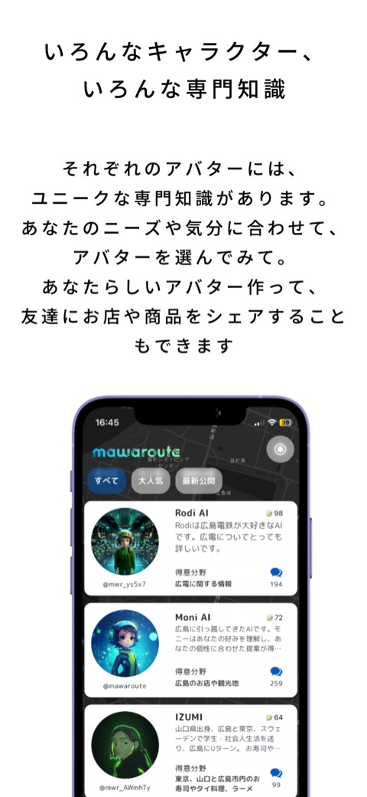
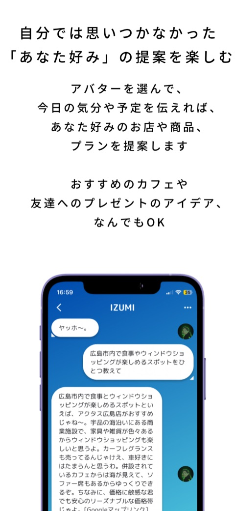
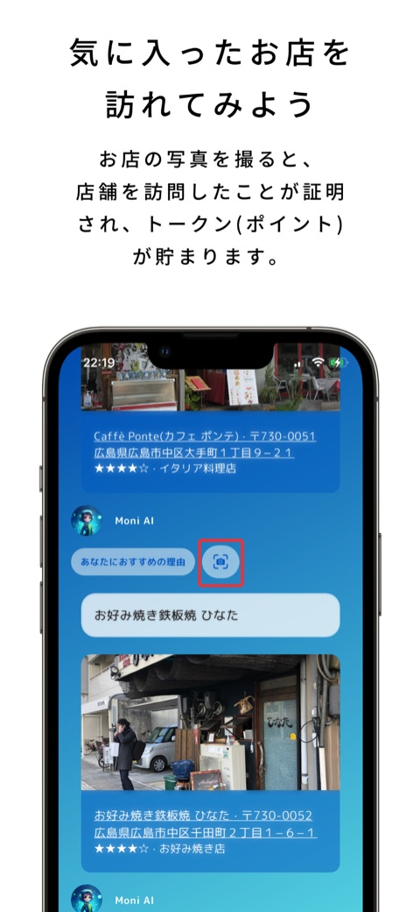
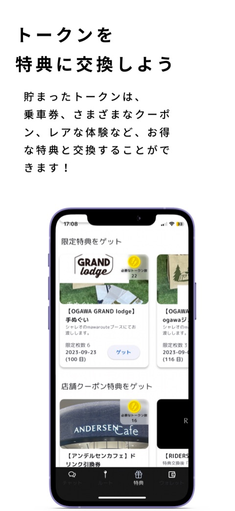
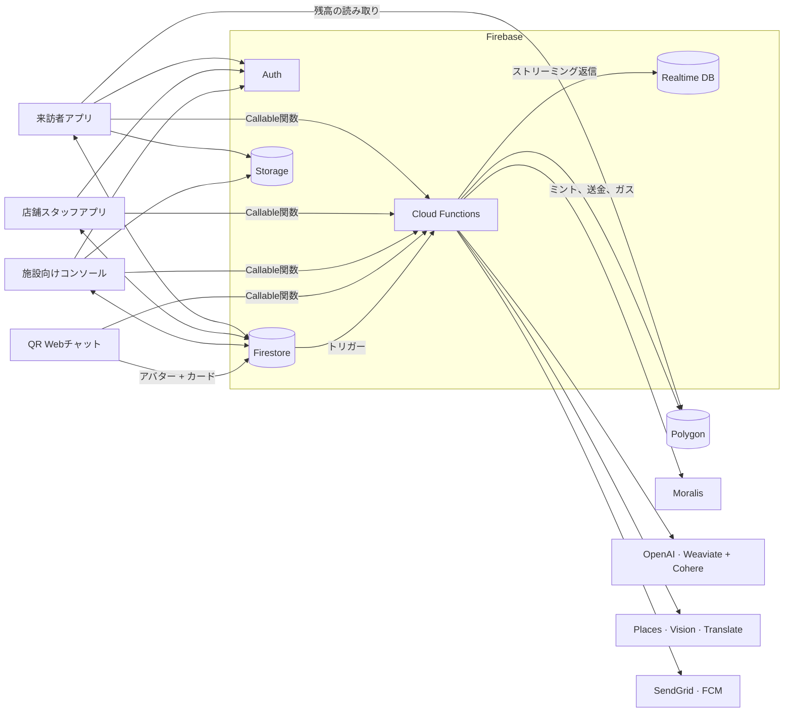

<a href="README.md">English</a> | <b>日本語</b>

# MaWaRoute（マワルト）— 訪れて、貯める

**「あなたに」ピッタリなおすすめを見つけて、お店を訪れて、特典をもらおう。**

<table>
  <tr>
    <td align="center"> 「あなたに」ピッタリなおすすめ</td>
    <td align="center"> いろんなキャラクター、いろんな専門知識</td>
    <td align="center"> アバターに予定を伝えて「あなた好み」の提案を</td>
    <td align="center"> お店の写真を撮ると訪問が証明され、トークンが貯まる</td>
    <td align="center"> 貯まったトークンを特典に交換</td>
  </tr>
</table>

スクリーンショットは、リリース済みの来訪者アプリ（2023年）のものです。ここで公開している最新ブランチでは、アプリのナビゲーションから特典タブへのリンクがなくなっています（<a href="#プロジェクトの状況">プロジェクトの状況</a>を参照）。

## 主な機能

- **AIガイドアバター**：アバターごとに個性と専門知識があります。来訪者とチャットし、自分のナレッジベースからお店や商品をおすすめします。
- **写真による訪問証明**：お店で撮った写真をそのお店の参照写真と照合し、訪問が確認されるとトークンがもらえます。
- **Polygon上の特典**：GGMT（ERC-20）トークンとNFTを、1つのミント用ウォレットから支払います。来訪者には、登録時にスマートフォン上のウォレットが作られます。
- **施設向けコンソール**：お店の招待、写真タスク付きキャンペーンの運営、特典の設定、ニュースの投稿ができます。
- **店舗スタッフアプリ**：来訪者のクーポンQRコードを読み取って、購入を記録します。
- **QR Webチャット**：お店に置いたQRコードから、そのお店のアバターとのチャットが開きます。アプリもサインインも不要です。
- 来訪者アプリでの**音声翻訳**（実験的機能）。

マワルトは、商業エリア向けの「Visit to Earn（訪れて稼ぐ）」プラットフォームです。**施設**（ショッピングモール、駅ビル、商店街など）が施設内のお店を招待し、キャンペーンを運営します。**来訪者**はエリアを歩きながら、お店をおすすめしてくれるAIガイドアバターとチャットし、お店で写真タスクをこなして、特典としてGGMTトークン（Polygon上のERC-20）を獲得します。トークンはクーポンやキャッシュバックに交換できます。**店舗スタッフ**は、来訪者のクーポンQRコードを読み取って購入を記録します。お店に置いたQRコードからは、そのお店のAIアバターとのWebチャットが開きます。アプリもサインインも不要です。

2022〜2023年に開発したものを当時のままオープンソース化し、Flutter、Node.js、Firebaseを現行バージョンにアップグレードしています。**まず[デプロイ前に](#デプロイ前に)を読んでください**。元のアクセス制御は、一般公開するデプロイには安全ではありません。

## リポジトリ構成

| フォルダ | 内容 | プラットフォーム |
| --- | --- | --- |
| [`apps/visitor`](apps/visitor) | 来訪者アプリ：電話番号によるサインイン、端末上のPolygonウォレット、AIガイドアバター、写真タスク、ウォレットと特典、実験的な音声翻訳 | Flutter、Android + iOS |
| [`apps/business`](apps/business) | 施設向けコンソール：お店、写真タスク付きキャンペーン、特典、ニュース、トークン保有者 | Flutter Web |
| [`apps/shop`](apps/shop) | 店舗スタッフアプリ：訪問と購入の記録、クーポンQRの読み取り | Flutter、Android + iOS |
| [`apps/qr-chat`](apps/qr-chat) | QRコードから開く、お店のAIアバターとのWebチャット | Flutter Web |
| [`functions`](functions) | バックエンドのすべて：トークンとNFT、AI、場所検索、画像解析、翻訳、メール、プッシュ通知、検索インデックスの同期を担う53個のCloud Functions | Node.js 22、Firebase Functions 第2世代 |
| [`contracts`](contracts) | 特典用のコントラクト（GGMT ERC-20、NFT、NFTマーケットプレイス）のコンパイル済みアーティファクト | Solidity（アーティファクトのみ） |
| [`ml/photo-match`](ml/photo-match) | タスクの写真を参照写真と照合する、Siameseネットワークの実験（アプリでは未使用） | Python、TensorFlow |

ルート直下のファイル：`firebase.json`（2つのWebアプリのHosting、ルール、Functions）、`firestore.rules`、`firestore.indexes.json`、`storage.rules`、`database.rules.json`。

## 仕組み

- **オンチェーンの特典。** Functionsがシークレットとして持つ1つのミント用ウォレットが、コントラクトを所有しています。このウォレットがGGMTのミントと送金、NFTのミントを行い、新しい来訪者のウォレットそれぞれに少額のガスを送ります。来訪者アプリは初回サインイン時に端末上でウォレットを作成し、残高をチェーンから直接読み取ります。
- **写真タスク。** 来訪者の写真をアップロードし、Cloud Visionのラベルとテキスト（`AnnotateImageV2`）を使って、お店の参照写真と比較します。
- **AIアバター。** 各アバターは、Firestore（`m_avatars`）にプロンプトを、Weaviate（`AvatarRec`、Cohereでベクトル化）におすすめ用のインデックスを持ちます。WeaviateとFirestoreの同期はFunctionsが行います。
- **お店と施設。** 施設向けコンソールは、お店をメールで招待します（`SendShopEmail` がスタッフのアカウントを作成）。店舗スタッフアプリは、スタッフが来訪者のクーポンQRコードを読み取ったときに、訪問と購入を記録します。

詳しくは各フォルダのREADMEを見てください。[`functions/README.md`](functions/README.md) には、すべての関数について、トリガー、シークレット、呼び出し元をまとめています。各アプリには、読み書きするデータをまとめた `BACKEND.md` またはREADMEのセクションがあります。

## デプロイ前に

以下は元のコードの性質です。どう直すかを判断できるよう、作ったときのまま残し、ここに記載しています。次の対応が済むまでは、本物のトークンや実際のユーザーで動かさないでください。

- **トークン関連の関数を制限する。** サインインしたユーザーなら誰でも、ミント・送金・ガス送付の関数を、任意の数量・任意の宛先で呼び出せてしまいます。ミント用ウォレットを空にされるおそれがあります。ロールのチェックと上限を追加してください。
- **クライアント側のキーをサーバーに移す。** 来訪者アプリは、アプリに埋め込まれたキーでOpenAI、Weaviate、Cohereを直接呼び出しています。店舗スタッフアプリの（どこからもリンクされていない）来訪者チャットも、同じ方法でOpenAIを呼び出しています。
- **ウォレットの鍵の扱いを見直す。** 来訪者アプリは、ウォレットの秘密鍵をFirestore（`m_users/{uid}/credentials`）と端末に保存しています。
- **ルールを厳しくする。** `firestore.rules` と `storage.rules` では、サインインしたユーザーなら誰でも、ほとんどのコレクションとすべてのファイルに書き込めます。RTDBの `chats` パスは誰でも読み取れます。
- **サインイン不要の関数に制限をかける。** アバターチャット、Weaviate検索、リンクプレビューの関数はサインインなしで呼び出せ（QRチャットにはサインインがありません）、レート制限もありません。

## セットアップ

前提条件：[Flutter 3.47.9](https://docs.flutter.dev/get-started/install)（各アプリに `.fvmrc` があります）、Node.js 22、Firebase CLI、そしてコントラクト用に、選んだチェーンのPOLを入れたウォレット。

1. **Firebaseプロジェクト。** Blazeプランでプロジェクトを作成します。Authentication（来訪者は電話番号、お店と施設はメール/パスワード）、Firestore、Realtime Database、Storageを有効にし、Cloud Vision、Cloud Translation、Places、Secret ManagerのAPIを有効にします。プロジェクトIDと2つのHostingサイトIDを `.firebaserc` に記入します。
2. **ルールとインデックス。** `firebase deploy --only firestore,storage,database`（先に[デプロイ前に](#デプロイ前に)を読んでください）。
3. **コントラクト。** PolygonのMumbaiテストネットは終了しています。ミント用ウォレットから、Polygon Amoy（チェーンID 80002）またはPolygonメインネットにアーティファクトをデプロイしてください。手順は [`contracts/README.md`](contracts/README.md) にあります。
4. **Functions。** [`functions/README.md`](functions/README.md) に載っているシークレットとパラメータ（ミント用ウォレットの鍵、RPC URL、チェーンID、コントラクトアドレス、Moralis、OpenAI、Google、SendGrid、Weaviate、Cohere）を設定し、`firebase deploy --only functions` を実行します。デプロイしない機能のシークレットは省略してかまいません。
5. **アプリ。** 各アプリで `config/example.json` を `config/<name>.json` にコピーして値を記入し、`--dart-define-from-file=config/<name>.json` を付けて実行します。ネイティブ側の設定（iOSの `Secrets.xcconfig`、Androidの署名）は各アプリのREADMEにあります。
6. **Webアプリ。** `apps/business` と `apps/qr-chat` をWeb向けにビルドし、`firebase deploy --only hosting` を実行します。

## プロジェクトの状況

MaWaRouteは、メンテナンスされる製品としてではなく、参考実装・出発点として公開しています。次の点に注意してください。

- 来訪者アプリは最新ブランチ（`dev_1.3.2`）のものです。このブランチでアプリはAIガイドとウォレットを中心にしたものになり、キャンペーン画面と施設の詳細画面は削除されました。施設向けコンソールでは、今も写真タスク付きのキャンペーンを作成できます。
- 開発を止めた時点で未完成だった画面があります。来訪者アプリのナビゲーションには特典タブへのリンクがなく、施設向けコンソールのElements画面とAds画面はレイアウトのみで、店舗スタッフアプリのいくつかの画面には開くためのボタンがありません。未完成の部分は各READMEに記載しています。
- Solidityのソースコードは残っておらず、コンパイル済みのアーティファクトだけがあります。
- アップグレード以降、実際のサービスに接続して動かしたものは一つもありません。AndroidとiOSのビルドも未検証です。

## コントリビュート

[CONTRIBUTING.md](CONTRIBUTING.md) を参照してください。

## ライセンス

MIT — [LICENSE](LICENSE) を参照してください。MaWaRoute（マワルト）の名称とロゴは、ライセンスの対象外です。
