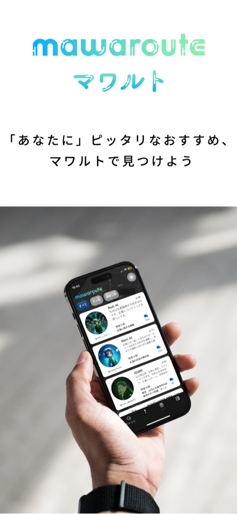
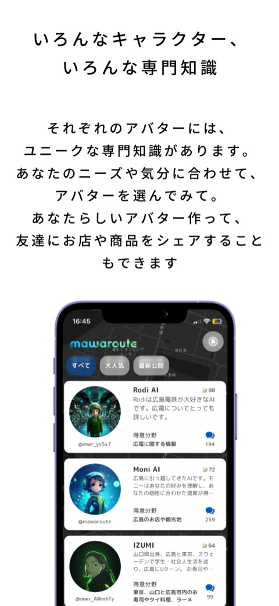
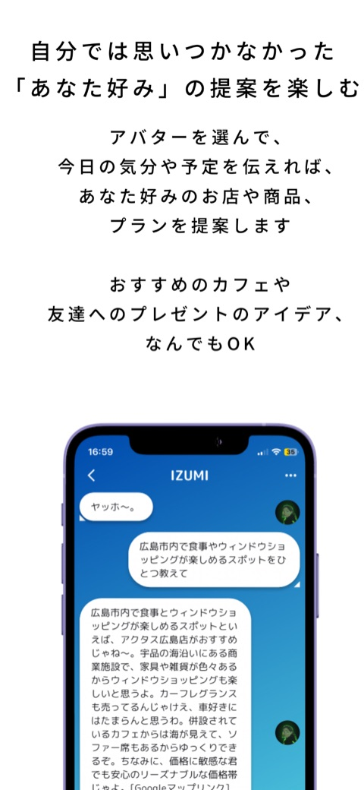
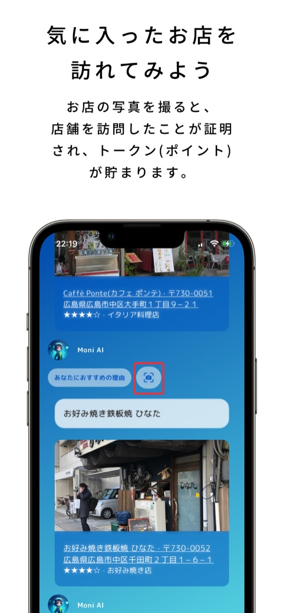
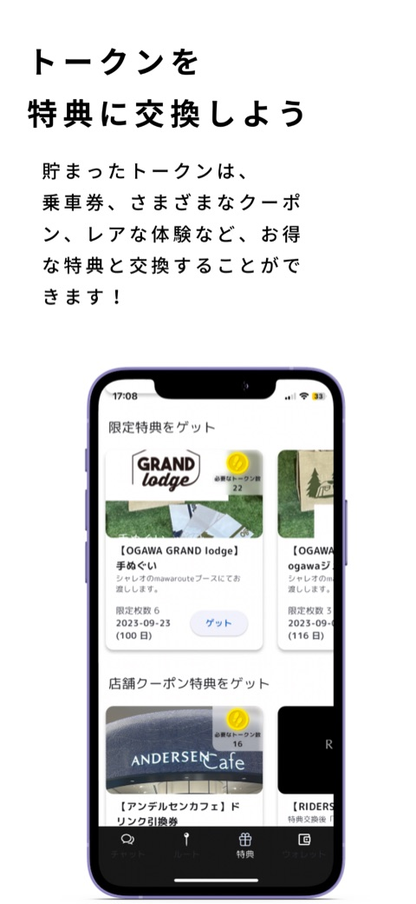
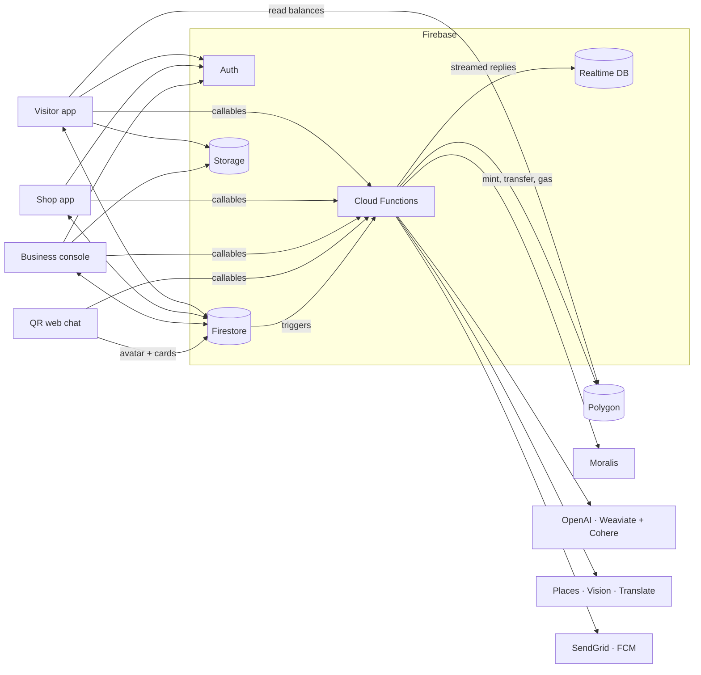

<b>English</b> | <a href="README.ja.md">日本語</a>

# MaWaRoute — visit to earn

**Find recommendations made for you, visit the shops, and earn rewards.**

<table>
  <tr>
    <td align="center"> Recommendations made for you</td>
    <td align="center"> AI guide avatars, each with its own expertise</td>
    <td align="center"> Tell an avatar your plans and get suggestions</td>
    <td align="center"> Take a photo at the shop to prove the visit and earn tokens</td>
    <td align="center"> Exchange tokens for coupons and rewards</td>
  </tr>
</table>

Screenshots from the released visitor app (2023). On the newest branch published here, the rewards tab is no longer linked from the app's navigation (see <a href="#project-status">Project status</a>).

## Features

- **AI guide avatars**: each avatar has its own personality and expertise,
  chats with visitors, and recommends shops and products from its own
  knowledge base.
- **Photo-proof visits**: a photo taken at the shop is checked against the
  shop's reference photo, and the visit earns tokens.
- **Rewards on Polygon**: GGMT (ERC-20) tokens and NFTs, paid from one
  minter wallet; each visitor gets a wallet on their phone at sign-up.
- **Business console** for a place: invite shops, run campaigns with photo
  tasks, set rewards, post news.
- **Shop app** for staff: scan a visitor's coupon QR code to record a purchase.
- **QR web chat**: a QR code at a shop opens a chat with its avatar, with no
  app or sign-in.
- **Voice translation** in the visitor app (experimental).

MaWaRoute is a "visit to earn" platform for shopping areas. A **place** (a
shopping mall, a station building, a shopping street) invites its shops and
runs campaigns. **Visitors** walk around, chat with AI guide avatars that
recommend shops, complete photo tasks at shops, and earn rewards as GGMT
tokens (ERC-20 on Polygon) that they can redeem for coupons and cash-back.
**Shop staff** scan a visitor's coupon QR code to record a purchase. A QR code
at a shop opens a web chat with that shop's AI avatar, with no app or sign-in.

It was built in 2022–2023 and is open-sourced as it was, upgraded to current
Flutter, Node.js and Firebase versions. **Read [Before you deploy](#before-you-deploy)
first**: the original access controls are not safe for a public deployment.

## What's in the repository

| Folder | What it is | Platform |
| --- | --- | --- |
| [`apps/visitor`](apps/visitor) | Visitor app: phone sign-in, an on-device Polygon wallet, AI guide avatars, photo tasks, wallet and rewards, experimental voice translation | Flutter, Android + iOS |
| [`apps/business`](apps/business) | Business console for a place: shops, campaigns with photo tasks, rewards, news, token holders | Flutter web |
| [`apps/shop`](apps/shop) | Shop staff app: visits and purchases, coupon QR scanning | Flutter, Android + iOS |
| [`apps/qr-chat`](apps/qr-chat) | Web chat with a shop's AI avatar, opened from a QR code | Flutter web |
| [`functions`](functions) | The whole backend: 53 Cloud Functions for tokens and NFTs, AI, places, vision, translation, email, push and search sync | Node.js 22, Firebase Functions 2nd gen |
| [`contracts`](contracts) | The reward contracts (GGMT ERC-20, NFT, NFT marketplace) as compiled artifacts | Solidity (artifacts only) |
| [`ml/photo-match`](ml/photo-match) | A siamese-network experiment for matching task photos to a reference photo (not used by the apps) | Python, TensorFlow |

Root files: `firebase.json` (hosting for the two web apps, rules, functions),
`firestore.rules`, `firestore.indexes.json`, `storage.rules`,
`database.rules.json`.

## How it works

- **Rewards on-chain.** One minter wallet, held by the functions as a secret,
  owns the contracts. It mints and transfers GGMT, mints NFTs, and sends a
  little gas to each new visitor wallet. The visitor app creates the wallet on
  the device at first sign-in and reads balances straight from the chain.
- **Photo tasks.** The visitor's photo is uploaded and compared with the shop's
  reference photo using Cloud Vision labels and text (`AnnotateImageV2`).
- **AI avatars.** Each avatar has prompts in Firestore (`m_avatars`) and a
  recommendation index in Weaviate (`AvatarRec`, vectorized with Cohere). The
  functions keep Weaviate in sync with Firestore.
- **Shops and places.** The business console invites a shop by email
  (`SendShopEmail` creates the staff account). The shop app records visits and
  purchases when staff scan a visitor's coupon QR code.

Each folder's README has the details. [`functions/README.md`](functions/README.md)
lists every function, its trigger, its secrets and its callers, and each app
has a `BACKEND.md` or README section listing what it reads and writes.

## Before you deploy

These are properties of the original code, kept as built and documented so
you can decide how to fix them. Don't run this with real tokens or real users
until you have:

- **Restricted the token functions.** Any signed-in user can call the mint,
  transfer and gas functions with any amount and recipient, which can drain
  the minter wallet. Add role checks and limits.
- **Moved client-side keys to the server.** The visitor app calls OpenAI,
  Weaviate and Cohere directly with keys compiled into the app, and the shop
  app's (unlinked) visitor chat calls OpenAI the same way.
- **Re-thought wallet keys.** The visitor app stores the wallet's private key
  in Firestore (`m_users/{uid}/credentials`) and on the device.
- **Tightened the rules.** `firestore.rules` and `storage.rules` let any
  signed-in user write most collections and every file; the RTDB `chats` path
  is public.
- **Put limits on the open functions.** The avatar chat, Weaviate search and
  link-preview functions need no sign-in (the QR chat has none) and have no
  rate limit.

## Getting started

Prerequisites: [Flutter 3.47.9](https://docs.flutter.dev/get-started/install)
(each app has an `.fvmrc`), Node.js 22, the Firebase CLI, and for the
contracts a wallet funded with POL on the chain you choose.

1. **Firebase project.** Create one on the Blaze plan. Turn on
   Authentication (phone for visitors, email/password for shops and places),
   Firestore, the Realtime Database and Storage, and enable the Cloud Vision,
   Cloud Translation, Places and Secret Manager APIs. Put the project id and
   the two hosting site ids in `.firebaserc`.
2. **Rules and indexes.** `firebase deploy --only firestore,storage,database`
   (read [Before you deploy](#before-you-deploy) first).
3. **Contracts.** Polygon's Mumbai testnet is gone; deploy the artifacts to
   Polygon Amoy (chain id 80002) or Polygon mainnet from the minter wallet.
   [`contracts/README.md`](contracts/README.md) shows how.
4. **Functions.** Set the secrets and params listed in
   [`functions/README.md`](functions/README.md) (minter key, RPC URL, chain id,
   contract addresses, Moralis, OpenAI, Google, SendGrid, Weaviate, Cohere),
   then `firebase deploy --only functions`. Skip the secrets of features you
   don't deploy.
5. **Apps.** In each app, copy `config/example.json` to `config/<name>.json`,
   fill it in, and run with `--dart-define-from-file=config/<name>.json`.
   Native settings (iOS `Secrets.xcconfig`, Android signing) are in each app's
   README.
6. **Web apps.** Build `apps/business` and `apps/qr-chat` for web, then
   `firebase deploy --only hosting`.

## Project status

MaWaRoute is published as a reference and starting point, not as a maintained
product. Things to know:

- The visitor app comes from the newest branch (`dev_1.3.2`), where the app
  became an AI guide plus wallet. Its campaign and place-detail screens were
  removed on that branch. The business console still creates campaigns with
  photo tasks.
- Some screens were unfinished when development stopped: the rewards tab is
  not linked in the visitor app's navigation, the business console's Elements
  and Ads screens are layout only, and several shop-app screens have no entry
  button. Each README lists what's unfinished.
- The Solidity sources were not kept, only the compiled artifacts.
- Nothing here has been run against live services since the upgrade, and the
  Android and iOS builds are untested.

## Contributing

See [CONTRIBUTING.md](CONTRIBUTING.md).

## License

MIT — see [LICENSE](LICENSE). The MaWaRoute name and logo are not covered by
the license.
